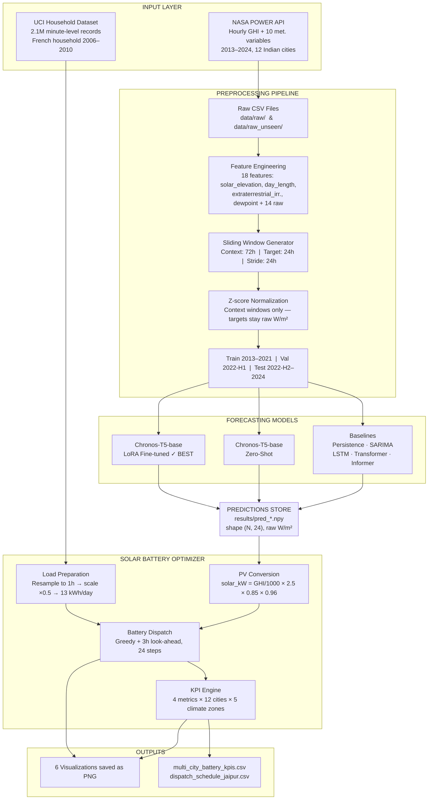
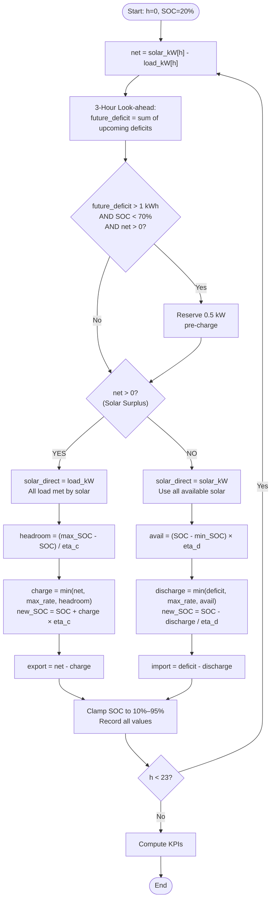

# Project Architecture, Methodology & Design Document

## Zero-Shot Solar Irradiance Forecasting for Indian Cities  
### + Intelligent Solar Battery Energy Management System (IEMS)

---

## Table of Contents

1. [Objectives & Problem Statement](#1-objectives--problem-statement)
2. [Overall System Architecture](#2-overall-system-architecture)
3. [Full Pipeline Flowchart](#3-full-pipeline-flowchart)
4. [Module 1 — Data Acquisition](#4-module-1--data-acquisition)
5. [Module 2 — Feature Engineering & Preprocessing](#5-module-2--feature-engineering--preprocessing)
6. [Module 3 — Forecasting Model Stack](#6-module-3--forecasting-model-stack)
7. [Module 4 — Evaluation Pipeline](#7-module-4--evaluation-pipeline)
8. [Module 5 — PV Conversion](#8-module-5--pv-conversion)
9. [Module 6 — Battery Dispatch Engine](#9-module-6--battery-dispatch-engine)
10. [Module 7 — KPI Engine](#10-module-7--kpi-engine)
11. [Battery Dispatch Algorithm Flowchart](#11-battery-dispatch-algorithm-flowchart)
12. [Data Flow & Tensor Shapes](#12-data-flow--tensor-shapes)
13. [City & Climate Configuration](#13-city--climate-configuration)
14. [Key Design Decisions](#14-key-design-decisions)
15. [Notebook Inventory](#15-notebook-inventory)

---

## 1. Objectives & Problem Statement

### The Two-Part Problem

#### Part A — Solar Irradiance Forecasting

Traditional ML models (LSTM, Transformer, SARIMA) require large amounts of city-specific training data and do not transfer across climate zones. This limits scalability for solar energy planning in data-sparse Indian regions.

**Core Research Question:**
> *Can a pre-trained foundation model (Amazon Chronos-T5) forecast 24-hour GHI across geographically diverse Indian cities in a zero-shot setting — without any city-specific retraining — and can LoRA fine-tuning close the performance gap efficiently?*

#### Part B — Energy Management

Raw irradiance predictions are not directly actionable. A homeowner or energy planner needs to know:
- How much electricity their solar panels will actually produce (kW)
- When to charge/discharge a battery to minimize grid dependency  
- What the environmental impact (CO₂) and self-sufficiency looks like per city and climate zone

**Goal:** Chain Stage 1 predictions → practical battery dispatch schedule → sustainability KPIs.

### Objectives Table

| # | Objective | Notebook |
|---|-----------|----------|
| 1 | Collect 11 years hourly GHI + meteorological data, 12 Indian cities | 01 |
| 2 | Engineer 18 physics-informed features, create sliding windows | 02 |
| 3 | Exploratory data analysis, seasonal and climate-zone patterns | 03 |
| 4 | Build Persistence, SARIMA, LSTM baselines | 04–05 |
| 5 | Build Transformer and Informer baselines | 06 |
| 6 | Evaluate Chronos-T5 zero-shot on all 12 cities | 07 |
| 7 | Fine-tune Chronos-T5 with LoRA, save adapters | 08 |
| 8 | Few-shot experiments and cross-climate transfer analysis | 09–10 |
| 9 | Comprehensive evaluation: MAE, RMSE, R², skill scores, daytime | 11 |
| 10 | Convert predictions → PV output → battery dispatch → KPIs | 16 |

---

## 2. Overall System Architecture

```
╔═══════════════════════════════════════════════════════════════════════════════╗
║                      STAGE 1 — FORECASTING RESEARCH                          ║
╠═══════════════════════════════════════════════════════════════════════════════╣
║                                                                               ║
║   ┌──────────────┐   ┌──────────────┐   ┌────────────────┐   ┌───────────┐  ║
║   │  NASA POWER  │   │ Preprocessing│   │ Sliding Window │   │  Models   │  ║
║   │  API         │──▶│ 18 features  │──▶│ 72h context    │──▶│  (×5)     │  ║
║   │  12 cities   │   │ z-score norm │   │ 24h target     │   │           │  ║
║   │  2013–2024   │   │              │   │ stride=24h     │   │           │  ║
║   └──────────────┘   └──────────────┘   └────────────────┘   └─────┬─────┘  ║
║                                                                     │        ║
║                          results/pred_*.npy ◀───────────────────────┘        ║
║                          12 cities × 5 models, shape (N,24), raw W/m²        ║
╠═══════════════════════════════════════════════════════════════════════════════╣
║                                    ▼                                          ║
╠═══════════════════════════════════════════════════════════════════════════════╣
║                    STAGE 2 — BATTERY OPTIMIZER (Notebook 16)                 ║
╠═══════════════════════════════════════════════════════════════════════════════╣
║                                                                               ║
║   pred_chronos_finetuned_*.npy ──▶ PV Conversion ──▶ Battery Dispatch        ║
║   (best model, pick sunny day)     GHI → solar_kW    Greedy look-ahead        ║
║                                    2.5kW, 85% eff.   5kWh, 10–95% SOC        ║
║                                                            │                  ║
║   UCI Household Data ──▶ Resample + Scale ─────────────────┘                 ║
║   (2.1M minute records)   1h intervals, ×0.5                                  ║
║                           ~13 kWh/day India                                   ║
║                                                                               ║
║                        KPI Engine ──▶ 6 Charts + 2 CSVs                      ║
║                        4 metrics × 12 cities × 5 climate zones               ║
╚═══════════════════════════════════════════════════════════════════════════════╝
```

### Stage Interfaces

| File | Producer | Consumer | Shape/Format | Content |
|------|----------|----------|--------------|---------|
| `pred_chronos_finetuned_{city}.npy` | NB 08 | NB 16 | `(729, 24)` float32 | Predicted GHI W/m², denormalized |
| `{city}_test_targets.npy` | NB 02 | NB 11, 16 | `(729, 24)` float32 | Ground truth GHI W/m² |
| `{city}_test_contexts.npy` | NB 02 | NB 07, 08 | `(729, 72, 18)` float32 | Normalized 3-day context windows |
| `household_power_consumption.txt` | UCI | NB 16 | `;`-delimited CSV | 1-min power kW, 2.1M rows |
| `city_info.json` | Manual | All NB | JSON dict | lat, lon, elevation, climate, state, role |
| `normalization_stats.json` | NB 02 | NB 05–08 | JSON dict | Z-score mean/std for 18 features |
| `models/chronos_lora/` | NB 08 | NB 14, app.py | LoRA adapter weights | Fine-tuned Chronos adapter |

---

## 3. Full Pipeline Flowchart



---

## 4. Module 1 — Data Acquisition

**Notebook:** `01_data_acquisition.ipynb`  
**Source:** NASA POWER (Prediction of Worldwide Energy Resources) API  
**URL:** `https://power.larc.nasa.gov/api/temporal/hourly/point`

### What is pulled

| Variable | Full Name | Unit | Role |
|----------|-----------|------|------|
| `ALLSKY_SFC_SW_DWN` | All-Sky Surface Shortwave Downward Irradiance | W/m² | **Target (GHI)** |
| `CLRSKY_SFC_SW_DWN` | Clear-Sky GHI | W/m² | Feature |
| `T2M` | Temperature at 2m | °C | Feature |
| `T2M_MAX` / `T2M_MIN` | Daily max/min temperature | °C | Feature |
| `RH2M` | Relative Humidity at 2m | % | Feature |
| `PRECTOTCORR` | Corrected Total Precipitation | mm/day | Feature |
| `PS` | Surface Pressure | kPa | Feature |
| `WS10M` | Wind Speed at 10m | m/s | Feature |
| `CLOUD_AMT` | Cloud Amount | % | Feature |
| `ALLSKY_SFC_SW_DIFF` | Diffuse Irradiance | W/m² | Feature |
| `CLRSKY_SFC_SW_DIFF` | Clear-Sky Diffuse | W/m² | Feature |
| `ALLSKY_SFC_UV_INDEX` | UV Index | — | Feature |
| `ALLSKY_SFC_PAR_TOT` | Photosynthetically Active Radiation | W/m² | Feature |

### Cities pulled

| City | State | Climate | Role | Lat | Lon |
|------|-------|---------|------|-----|-----|
| Jaipur | Rajasthan | BWh (Hot Desert) | Train | 26.91 | 75.79 |
| Delhi | NCT | Cwa (Humid Subtropical) | Train | 28.70 | 77.10 |
| Guwahati | Assam | Cwa | Train | 26.14 | 91.74 |
| Ahmedabad | Gujarat | BSh (Hot Semi-Arid) | Train | 23.02 | 72.57 |
| Chennai | Tamil Nadu | Aw (Tropical Savanna) | Train | 13.08 | 80.27 |
| Thiruvananthapuram | Kerala | Am (Tropical Monsoon) | Train | 8.52 | 76.94 |
| Nagpur | Maharashtra | Aw | Train | 21.15 | 79.09 |
| Hyderabad | Telangana | BSh | **Test (unseen)** | 17.39 | 78.49 |
| Bangalore | Karnataka | Aw | **Test (unseen)** | 12.97 | 77.59 |
| Kolkata | West Bengal | Aw | **Test (unseen)** | 22.57 | 88.36 |
| Lucknow | Uttar Pradesh | Cwa | **Test (unseen)** | 26.85 | 80.95 |
| Jodhpur | Rajasthan | BWh | **Test (unseen)** | 26.24 | 73.02 |

> 7 training cities span all 5 climate zones. 5 test cities are geographically and climatically separate — used only for zero-shot and fine-tuned model evaluation.

### Storage format

```
data/
  raw/
    jaipur_raw_2013_2024.csv         # ~96,000 rows per city
    delhi_raw_2013_2024.csv
    ...
  raw_unseen/
    hyderabad_raw_2013_2024.csv
    bangalore_raw_2013_2024.csv
    ...
```

---

## 5. Module 2 — Feature Engineering & Preprocessing

**Notebook:** `02_preprocessing_feature_engineering.ipynb`

### Computed Features (added on top of raw API variables)

| Feature | Computation | Why |
|---------|-------------|-----|
| `solar_elevation` | `pvlib.solarposition.get_solarposition(lat, lon, dt)` | Direct geometric predictor of GHI; zero at night |
| `day_length` | Hours between sunrise and sunset (pvlib) | Captures seasonal variation in solar window |
| `extraterrestrial_irradiance` | Top-of-atmosphere solar flux (pvlib) | Upper bound for GHI; defines clear-sky ratio |
| `dewpoint` | `T2M - ((100 - RH2M) / 5)` | Proxy for atmospheric water vapor (cloud formation) |

### Sliding Window Construction

```
Full time series (hourly):  [ t=0, t=1, t=2, ..., t=T ]

Window at position i:
  Context:  [ t=i,   t=i+1,  ..., t=i+71  ]   shape: (72, 18)  — 3 days
  Target:   [ t=i+72, t=i+73, ..., t=i+95  ]   shape: (24,)     — 1 day forecast

Stride = 24h (one new window per day)
```

**Total windows per city:**
- Training: ~2,915 windows (2013–2021)
- Validation: ~165 windows (2022-H1)
- Test: ~729 windows (2022-H2 to 2024)

### Normalization

**Context windows:** Z-score normalized per feature using training statistics only (to prevent data leakage):
```
x_norm = (x - mean_train) / std_train
```

**Target values:** NOT normalized. Stored as raw GHI in W/m². This allows direct metric computation after inference.

```
Normalization stats (mean, std) for ALLSKY_SFC_SW_DWN (GHI):
  mean = 210.82 W/m²
  std  = 288.14 W/m²
```

### Storage format

```
data/processed/windows/
  jaipur_train_contexts.npy     shape: (2915, 72, 18)  — normalized
  jaipur_train_targets.npy      shape: (2915, 24)       — raw W/m²
  jaipur_val_contexts.npy       shape: (165, 72, 18)
  jaipur_val_targets.npy        shape: (165, 24)
  jaipur_test_contexts.npy      shape: (729, 72, 18)
  jaipur_test_targets.npy       shape: (729, 24)
  ... (×12 cities)
  feature_columns.json          list of 18 feature names
```

---

## 6. Module 3 — Forecasting Model Stack

### Model Comparison Table

| Model | Type | Input | Training | Inference |
|-------|------|-------|----------|-----------|
| Persistence | Heuristic | Last observed 24h | None | GHI[t-24:t] copied |
| SARIMA | Statistical | Univariate GHI | Per-city ARIMA fitting | Seasonal (24h period) |
| LSTM | Deep Learning | (72, 18) context | Multi-city joint | Sequence-to-sequence |
| Transformer | Deep Learning | (72, 18) context | Multi-city joint | Encoder-decoder |
| Informer | Deep Learning | (72, 18) context | Multi-city joint | Sparse attention |
| **Chronos-T5 ZS** | Foundation | GHI history only | **None (zero-shot)** | Tokenized time series |
| **Chronos-T5 FT** | Foundation | GHI history only | LoRA on training cities | **Best performer** |

### Chronos-T5 — How it Works

Amazon Chronos-T5-base is a language model pre-trained on **millions of time series** from diverse domains. It treats time series forecasting as a **language modelling problem**:

```
1. Input GHI values (72h context) are scaled to [-1, +1]
2. Values are discretized into 4096 tokens (vocabulary)
3. T5 encoder-decoder processes the token sequence
4. Decoder generates 24 future tokens autoregressively
5. Tokens are de-quantized back to W/m² values
6. RevIN denormalization is applied
```

### Chronos LoRA Fine-Tuning

Rather than retraining the full 200M parameter model, only small adapter matrices are trained:

```
LoRA Configuration:
  r           = 16          # rank of adapter matrices
  alpha       = 32          # scaling factor
  target_modules = ["q", "v"]  # query + value attention projections
  dropout     = 0.05
  Trainable params ≈ 0.3M out of 200M (0.15%)

Training:
  Learning rate = 1e-4
  Batch size    = 8
  Epochs        = 20 (with patience=5 early stopping)
  Loss          = MSE on normalized targets
  Data          = all 7 training cities combined
```

### RevIN (Reversible Instance Normalization)

Used during Chronos fine-tuning to handle the large value range of GHI:

```python
# Before inference:
ctx_mean = context.mean()
ctx_std  = context.std() + 1e-8
context_norm = (context - ctx_mean) / ctx_std

# After inference:
predictions = predictions * ctx_std + ctx_mean   # denormalize
predictions = np.clip(predictions, 0, 1400)      # clip to valid W/m² range
```

---

## 7. Module 4 — Evaluation Pipeline

**Notebook:** `11_evaluation_comparison.ipynb`

### Metrics Used

| Metric | Formula | Meaning |
|--------|---------|---------|
| MAE | $\frac{1}{N}\sum|y - \hat{y}|$ | Mean absolute error in W/m² |
| RMSE | $\sqrt{\frac{1}{N}\sum(y - \hat{y})^2}$ | Root mean squared error in W/m² |
| R² | $1 - \frac{\sum(y-\hat{y})^2}{\sum(y-\bar{y})^2}$ | Variance explained (1.0 = perfect) |
| Skill Score | $1 - \frac{RMSE_{model}}{RMSE_{persistence}}$ | Improvement over naive baseline (> 0 = better) |
| nRMSE | $RMSE / \bar{y}$ | Normalized RMSE — comparable across cities |

### Evaluation Splits

- **Standard:** All 729 test windows per city
- **Daytime only:** Hours where GHI > 50 W/m² (avoids inflating accuracy at night)
- **Cross-climate:** Evaluate on 5 unseen test cities (spatial generalization)

---

## 8. Module 5 — PV Conversion

**Notebook:** `16_solar_battery_optimizer.ipynb`

### Formula

$$\text{solar\_kW}[h] = \frac{\text{GHI}[h]}{1000} \times P_{\text{peak}} \times \eta_{\text{derating}} \times \eta_{\text{inverter}}$$

Where:
- $\text{GHI}[h]$ — predicted irradiance at hour h in W/m²
- $P_{\text{peak}} = 2.5$ kW — STC-rated panel capacity (already includes cell efficiency)
- $\eta_{\text{derating}} = 0.85$ — system derating factor (temperature losses ~8%, soiling ~3%, mismatch ~2%, wiring ~2%)
- $\eta_{\text{inverter}} = 0.96$ — string inverter efficiency

**Inverter cutoff:** If GHI[h] < 50 W/m², solar_kW[h] = 0 (inverter cannot operate below threshold)

### Why system_derating instead of panel_efficiency?

The STC (Standard Test Conditions) rating of 2.5 kW already embeds panel cell efficiency. Adding another efficiency factor would double-count. The derating factor instead captures **real-world losses** that aren't reflected in STC ratings.

### Example Output (Jaipur sunny day)
```
Hour 11:00 → GHI = 1031 W/m²
solar_kW = (1031 / 1000) × 2.5 × 0.85 × 0.96
         = 1.031 × 2.5 × 0.85 × 0.96
         = 2.10 kW

Hour 02:00 → GHI = 0 W/m²  (night)
solar_kW = 0.0  (inverter cutoff)
```

---

## 9. Module 6 — Battery Dispatch Engine

**Notebook:** `16_solar_battery_optimizer.ipynb`, function `simulate_battery_dispatch()`

### Battery Parameters

| Parameter | Value | Notes |
|-----------|-------|-------|
| Capacity | 5.0 kWh | Typical residential LFP battery |
| Max charge rate | 2.5 kW | 0.5C rate — safe for battery longevity |
| Max discharge rate | 2.5 kW | 0.5C rate |
| Round-trip efficiency | 92% | Charge: √0.92 ≈ 95.9% each direction |
| Min SOC | 10% | 0.5 kWh reserved — prevents deep discharge |
| Max SOC | 95% | 4.75 kWh max usable — prevents overcharge |
| Initial SOC | 20% | Conservative start for morning hours |

### State Machine — Per-Hour Logic

```
For each hour h = 0 to 23:

  net[h] = solar_kW[h] - load_kW[h]

  ── 3-HOUR LOOK-AHEAD CHECK ──
  future_deficit = Σ max(0, load[h+j] - solar[h+j]) for j = 1,2,3
  IF future_deficit > 1.0 kWh  AND  SOC < 70%  AND  net[h] > 0:
      pre_charge 0.5 kW now (battery reservation)

  ── DISPATCH DECISION ──
  IF net[h] > 0:   (solar surplus)
      solar_direct[h] = load_kW[h]          ← all load met by solar
      charge_headroom = (max_SOC − SOC) / η_c
      charge[h] = min(net[h], max_charge_kw, charge_headroom)
      SOC[h+1]  = SOC[h] + charge[h] × η_c
      export[h] = net[h] - charge[h]        ← remainder to grid

  IF net[h] <= 0:  (solar deficit)
      solar_direct[h] = solar_kW[h]          ← use all solar
      deficit = -net[h]
      avail = (SOC[h] - min_SOC) × η_d
      discharge[h] = min(deficit, max_discharge_kw, avail)
      SOC[h+1]    = SOC[h] - discharge[h] / η_d
      import[h]   = deficit - discharge[h]   ← remainder from grid

  SOC[h+1] = CLAMP(SOC[h+1], min_SOC, max_SOC)
```

### Load Profile Preparation (UCI Dataset)

```
UCI household_power_consumption.txt
  - 2,049,280 rows, minute-level
  - Columns: Date; Time; Global_active_power (kW); ...
  - French household, 2006–2010

Processing:
  1. Parse datetime from Date + Time columns
  2. resample('1H').mean()  →  34,168 hourly values
  3. × 0.50 scaling factor  →  Indian consumption levels
  4. Extract 1,417 complete 24h day profiles
  5. Select median-consumption day (representative, not extreme)

Result:
  French original avg:  26.2 kWh/day
  Indian scaled avg:    13.1 kWh/day
  Hourly range:         0.06 – 3.28 kW
  Shape used:           (24,) hourly kW
```

---

## 10. Module 7 — KPI Engine

**Function:** `compute_kpis(result)` in Notebook 16

### KPI Formulas

| KPI | Formula | Unit | Interpretation |
|-----|---------|------|----------------|
| **Self-Sufficiency %** | $(1 - \frac{\sum \text{grid\_import}}{\sum \text{load}}) \times 100$ | % | % of load met without drawing from grid |
| **CO₂ Avoided** | $(\sum \text{load} - \sum \text{grid\_import}) \times 0.82$ | kg/day | Emissions offset vs. full grid supply. 0.82 kg/kWh = India grid emission factor (2024) |
| **Peak Hours Avoided** | Count of hours where `grid_import < 0.1 kW` AND `load > 0.3 kW` | count/day | Hours of grid independence during active consumption |
| **Solar Self-Consumption %** | $\frac{\text{solar\_direct} + \text{battery\_charge}}{\sum \text{solar}} \times 100$ | % | % of generated solar used on-site (vs. exported waste) |

### Energy Balance Conservation Check

After every simulation the following must hold (verified in notebook):

```
1. LOAD BALANCE:
   solar_direct + battery_discharge + grid_import = total_load  (every hour)

2. SOLAR BALANCE:
   solar_direct + battery_charge + grid_export = total_solar    (every hour)

3. SOC BOUNDS:
   min_soc ≤ SOC[h] ≤ max_soc   for all h
```

---

## 11. Battery Dispatch Algorithm Flowchart



---

## 12. Data Flow & Tensor Shapes

```
NASA POWER API
    │
    ▼
Raw CSV  →  shape: (~96,000 rows × 13 columns)  per city
    │
    ▼  [Feature Engineering: +4 computed features]
Feature Matrix  →  shape: (n_hours × 18)  per city, float64
    │
    ▼  [Sliding window, stride=24, context=72, target=24]
    ├── contexts  →  shape: (N, 72, 18)  normalized float32
    └── targets   →  shape: (N, 24)      raw W/m² float32
              │
              ▼  split N → (N_train, N_val, N_test)
              │
              ▼  [Model Inference]
    predictions  →  shape: (N_test, 24)  raw W/m² float32
    saved to:  results/pred_{model}_{city}.npy
              │
              ▼  [Single 24h slice: predictions[day_idx] → shape (24,)]
              │
    ┌──────────────────────────────────────────────────────┐
    │               BATTERY OPTIMIZER                      │
    │                                                      │
    │  irradiance_24h  shape: (24,)   W/m²                 │
    │       ↓ PV conversion                                │
    │  solar_kw        shape: (24,)   kW                   │
    │                                                      │
    │  load_24h        shape: (24,)   kW  ← UCI dataset    │
    │                                                      │
    │  ↓ simulate_battery_dispatch()                       │
    │                                                      │
    │  Output dict with arrays each shape (24,):           │
    │    solar_kw, load_kw                                 │
    │    soc_pct, soc_pct_end                              │
    │    charge_kw, discharge_kw                           │
    │    grid_import_kw, grid_export_kw                    │
    │    solar_direct_kw                                   │
    │                                                      │
    │  ↓ compute_kpis()  →  dict of 11 scalar KPIs        │
    └──────────────────────────────────────────────────────┘
              │
              ▼
    Multi-city loop → df_kpis  shape: (12 cities × 11 KPI columns)
    Climate aggregation → climate_agg  shape: (5 zones × 7 columns)
```

---

## 13. City & Climate Configuration

### Köppen Climate Zone Summary

| Zone | Name | Cities | Characteristics | Solar Impact |
|------|------|--------|----------------|--------------|
| **BWh** | Hot Desert | Jaipur, Jodhpur | < 250mm rain/year, 9–10h sun/day | Highest irradiance potential |
| **BSh** | Hot Semi-Arid | Ahmedabad, Hyderabad | Seasonal dry, moderate cloud | High but variable |
| **Aw** | Tropical Savanna | Chennai, Nagpur, Bangalore, Kolkata | Monsoon + dry season | Strong monsoon dip |
| **Cwa** | Humid Subtropical | Delhi, Guwahati, Lucknow | Hot summer, cool dry winter | Seasonal variation |
| **Am** | Tropical Monsoon | Thiruvananthapuram | Year-round rain, moderate cloud | Lowest clear-sky days |

### Why 5 Climate Zones Matter

Training Chronos-T5 on 7 cities spanning all 5 zones means the fine-tuned model learns zone-specific irradiance patterns (monsoon dips, desert peaks, seasonal variation). Testing on 5 **unseen** cities in the same zones validates **intra-zone generalization** — the model never saw Hyderabad but it saw Ahmedabad (both BWh/BSh).

---

## 14. Key Design Decisions

### Why Chronos-T5 (Foundation Model)?

| Decision | Rationale |
|----------|-----------|
| Use pre-trained foundation model | Leverages patterns from millions of diverse time series — general temporal reasoning pre-built |
| Zero-shot first, fine-tune second | Establishes baseline; fine-tuning only if zero-shot gap is significant |
| LoRA (not full fine-tuning) | Only 0.15% of parameters trained — faster, no catastrophic forgetting, works with limited data |
| Univariate Chronos input | Chronos was pre-trained on univariate series; multivariate context fed as separate features to LSTM/Transformer |

### Why RevIN (Reversible Instance Normalization)?

GHI varies enormously — from 0 W/m² at night to 1400 W/m² at solar noon. RevIN normalizes each input context sequence to zero mean/unit variance, making it distribution-agnostic. This is critical for a pre-trained model that wasn't trained specifically on GHI.

### Why 72h Context, 24h Horizon?

- **72h (3 days):** Sufficient to capture multi-day weather patterns and cloud cover cycles without excessive padding
- **24h horizon:** Operationally meaningful for day-ahead energy scheduling, aligns with utility dispatch cycles
- **Stride 24h:** Each window represents the forecast task for one full day, non-overlapping forecast horizons

### Why Targets are NOT Normalized?

Keeping targets in raw W/m² allows:
- Direct metric computation (MAE, RMSE in actual W/m²) without inverse transform
- Clean interface with Stage 2 (battery optimizer reads W/m² directly)
- Avoids error accumulation from two normalization steps

### Why UCI Dataset + Scaling (not Real Indian Data)?

No publicly available minute-level Indian residential smart meter dataset exists. The UCI dataset provides:
- Real measurement noise and day-to-day variability (unlike synthetic)
- Natural load patterns (morning peaks, evening peaks, overnight baseline)
- 4 years of data — 1,417 complete daily profiles to sample from

Scaling by 0.5× maps the French household's 26.2 kWh/day to 13.1 kWh/day, consistent with Indian urban residential consumption (BEE census data: 8–15 kWh/day for 2–3 BHK apartments).

### Why System Derating (not Panel Efficiency) in PV Formula?

```
WRONG: solar_kW = (GHI/1000) × 2.5 × 0.18 × 0.96
         (panel STC rating already encodes 18% cellefficiency — double counting!)

CORRECT: solar_kW = (GHI/1000) × 2.5 × 0.85 × 0.96
         (derating = temp loss + soiling + mismatch + wiring ≈ 15% total loss)
```

### Why India's CO₂ Factor (0.82 kg/kWh) not Generic (0.40)?

India's power grid is heavily coal-dependent (~70% thermal generation). The Central Electricity Authority (CEA) emission factor for 2023–24 is 0.82 kg CO₂/kWh — twice the European average. Using 0.40 would underestimate the climate impact of solar adoption in India by 2×.

---

## 15. Notebook Inventory

| Notebook | Purpose | Key Output |
|----------|---------|------------|
| `01_data_acquisition.ipynb` | Pull NASA POWER data for all cities | `data/raw/*.csv` |
| `02_preprocessing_feature_engineering.ipynb` | Feature eng., windows, normalization | `data/processed/windows/*.npy` |
| `03_eda_visualization.ipynb` | Exploratory analysis, seasonal patterns | EDA plots |
| `04_baseline_persistence_arima.ipynb` | Persistence + SARIMA baselines | `results/pred_persistence_*.npy` |
| `05_baseline_lstm.ipynb` | LSTM multi-city model | `models/lstm_multicity.pt`, predictions |
| `06_baseline_transformer_informer.ipynb` | Transformer + Informer | `models/transformer.pt`, `models/informer.pt` |
| `07_chronos2_zeroshot.ipynb` | Chronos-T5 zero-shot inference | `results/pred_chronos_zeroshot_*.npy` |
| `08_chronos2_finetuning.ipynb` | LoRA fine-tuning + inference | `models/chronos_lora/`, `results/pred_chronos_finetuned_*.npy` |
| `09_fewshot_experiments.ipynb` | K-shot adaptation experiments | Few-shot results |
| `10_cross_climate_analysis.ipynb` | Climate zone transfer analysis | Cross-climate metrics |
| `11_evaluation_comparison.ipynb` | Full model comparison | `results/comprehensive_results.csv` |
| `12_iems_prototype.ipynb` | IEMS dashboard prototype | `results/iems_dashboard.html` |
| `13_unseen_city_validation.ipynb` | Validation on unseen cities | Unseen city metrics |
| `14_finetuned_chronos_unseen.ipynb` | Fine-tuned model on unseen | Fine-tuned unseen results |
| `15_daytime_evaluation.ipynb` | Daytime-only metric analysis | `results/daytime_evaluation_results.csv` |
| `15_results_visualization.ipynb` | Paper-quality result charts | Publication plots |
| **`16_solar_battery_optimizer.ipynb`** | **PV + battery + KPIs** | **6 charts, 2 CSVs** |
| `00_architecture_methodology.ipynb` | This document (interactive) | Architecture reference |

---

## Appendix A — Configuration Dump

```python
PV_CONFIG = {
    'panel_peak_kw': 2.5,        # STC rated capacity
    'system_derating': 0.85,     # Real-world loss factor
    'inverter_efficiency': 0.96, # String inverter
    'min_irradiance_threshold': 50,  # W/m² cutoff
}

BATTERY_CONFIG = {
    'capacity_kwh': 5.0,
    'max_charge_kw': 2.5,        # 0.5C
    'max_discharge_kw': 2.5,     # 0.5C
    'roundtrip_efficiency': 0.92,
    'charge_efficiency': sqrt(0.92),    # ≈ 0.959
    'discharge_efficiency': sqrt(0.92), # ≈ 0.959
    'min_soc': 0.10,
    'max_soc': 0.95,
    'initial_soc': 0.20,
}

GRID_CONFIG = {
    'india_emission_factor': 0.82,  # kg CO₂/kWh (CEA 2023-24)
    'peak_hours': [18, 19, 20, 21], # 6PM–10PM Indian evening peak
}

LOAD_SCALE_FACTOR = 0.50
# Maps UCI French household (26.2 kWh/day) → Indian residential (13.1 kWh/day)

CITY_SPLITS = {
    'train': ['jaipur', 'delhi', 'guwahati', 'ahmedabad', 'chennai',
              'thiruvananthapuram', 'nagpur'],
    'test':  ['hyderabad', 'bangalore', 'kolkata', 'lucknow', 'jodhpur'],
}

CHRONOS_LORA_CONFIG = {
    'r': 16, 'lora_alpha': 32,
    'target_modules': ['q', 'v'],
    'lora_dropout': 0.05,
    'lr': 1e-4, 'batch_size': 8, 'epochs': 20, 'patience': 5,
}
```

---

## Appendix B — Results Summary

### Multi-City Battery Simulation (Chronos Fine-Tuned, Median Load Day)

| City | Climate | Self-Sufficiency | Solar Self-Consump. | CO₂ Avoided/day |
|------|---------|-----------------|---------------------|-----------------|
| Lucknow | Cwa | **85%** | 96% | 7.4 kg |
| Guwahati | Cwa | 84% | 90% | 6.6 kg |
| Bangalore | Aw | 81% | 66% | 4.5 kg |
| Thiruvananthapuram | Am | 78% | 78% | 6.4 kg |
| Nagpur | Aw | 75% | 86% | 6.5 kg |
| Jaipur | BWh | 72% | 85% | 7.2 kg |
| Delhi | Cwa | 69% | 97% | 7.5 kg |
| Chennai | Aw | 69% | 92% | 8.1 kg |
| Hyderabad | BSh | 64% | 94% | 8.1 kg |
| Kolkata | Aw | 59% | 88% | 6.0 kg |
| Jodhpur | BWh | 59% | 88% | 7.7 kg |
| Ahmedabad | BSh | **56%** | 94% | **8.2 kg** |

### Climate Zone Summary

| Zone | Name | Avg Self-Sufficiency | Avg CO₂ Avoided |
|------|------|--------------------|-----------------|
| Cwa | Humid Subtropical | 80% | 7.2 kg |
| Am | Tropical Monsoon | 78% | 6.4 kg |
| Aw | Tropical Savanna | 71% | 6.2 kg |
| BWh | Hot Desert | 66% | 7.4 kg |
| BSh | Hot Semi-Arid | 60% | 8.2 kg |

> **Insight:** Hot semi-arid cities (BSh) generate the most solar energy and avoid the most CO₂ — but their self-sufficiency is lower because the high irradiance outpaces the 5 kWh battery's ability to store surplus. Increasing battery size to 10 kWh would likely push BSh self-sufficiency above 80%.
