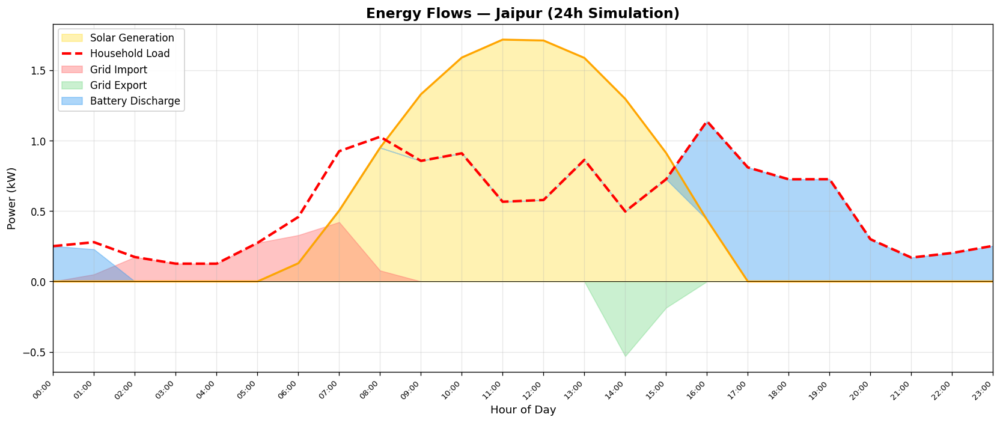
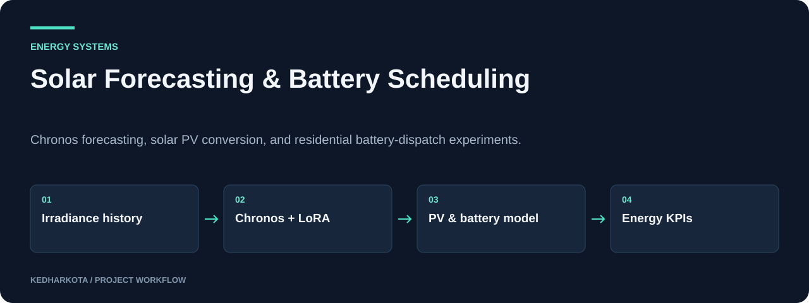
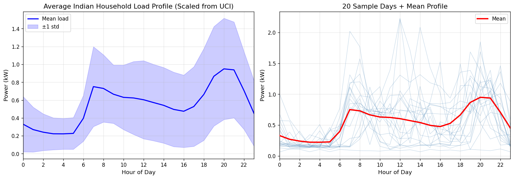

# Solar Forecasting & Battery Scheduling

Chronos forecasting, solar PV conversion, and residential battery-dispatch experiments.

**Python · Chronos-T5 · LoRA · PyTorch · Gradio**

[](https://github.com/kedharkota/LLM-Assisted-Energy-Management-System-with-Optimal-Battery-Scheduling/actions/workflows/docs.yml)

[Overview](#overview) · [Getting started](#getting-started) · [Repository guide](#repository-guide) · [Reproducibility](docs/REPRODUCIBILITY.md)

<p align="center">
  
</p>

[Open full-size visual](docs/assets/notebook-2.png)

*Original Jaipur energy-flow simulation output from notebook 16.*

## Project at a glance

| Detail | Project information |
| --- | --- |
| **Focus** | Solar forecasting connected to household energy simulation |
| **Start here** | [ARCHITECTURE.md](ARCHITECTURE.md) |
| **Run mode** | Jupyter experiments and Gradio; external data and model artifacts |
| **Explore** | Irradiance forecasts, PV output, battery schedules, and energy KPIs |

## Overview

A notebook-based study connecting solar irradiance forecasting with household energy management. The project explores baseline forecasts, Chronos adaptation, unseen-location validation, and battery simulations, with a Gradio app for forecasting and energy comparisons.

## What this project includes

- Data acquisition, preprocessing, exploratory analysis, and baseline notebooks.
- Chronos-T5 forecasting with LoRA adaptation and validation across locations.
- Irradiance-to-PV conversion and battery charge/discharge simulation.
- Gradio interface with forecasting, energy simulation, city comparison, results exploration, and CSV upload.

## Workflow

<p align="center">
  
</p>

[Open full-size visual](docs/assets/overview.svg)

*Explanatory diagram. Detailed implementation and availability notes follow below.*

## Getting started

Use a Python environment appropriate for the PyTorch, Transformers, PEFT, Chronos, and Gradio versions used by the notebooks. A tested dependency lockfile is not committed.

Start by opening the acquisition and preprocessing notebooks in Jupyter, then follow the numbered experiments. Review their installation cells and replace local paths before execution.

After restoring the data, dependencies, and model artifacts:

```bash
python app_enhanced.py
```

The app is configured for port **7861**. It binds to `0.0.0.0`; use a local environment or review the host configuration before exposing it.

### Required inputs and current constraints

The app expects external data under `data/raw/` and `data/raw_unseen/`, result tables under `results/`, and the LoRA adapter at `chronos_lora/chronos_lora/`. The optimizer also references city metadata, forecast outputs, and the UCI household power-consumption file. These artifacts are not present in the root tree and must be recreated or supplied.

## Repository guide

| File | Purpose |
| --- | --- |
| [new_01_data_acquisition.ipynb](new_01_data_acquisition.ipynb) | Data acquisition workflow. |
| [new_02_preprocessing.ipynb](new_02_preprocessing.ipynb) | Preprocessing. |
| [new_03_eda.ipynb](new_03_eda.ipynb) | Exploratory analysis. |
| [new_04_baselines.ipynb](new_04_baselines.ipynb) | Forecasting baselines. |
| [new_05_chronos.ipynb](new_05_chronos.ipynb) | Chronos experiments. |
| [new_06_evaluation.ipynb](new_06_evaluation.ipynb) | Forecast evaluation. |
| [new_07_unseen_validation.ipynb](new_07_unseen_validation.ipynb) | Validation on unseen locations. |
| [new_08_fewshot.ipynb](new_08_fewshot.ipynb) | Few-shot adaptation. |
| [15_daytime_evaluation.ipynb](15_daytime_evaluation.ipynb) | Daytime evaluation. |
| [16_solar_battery_optimizer.ipynb](16_solar_battery_optimizer.ipynb) | PV conversion and battery simulation. |
| [app_enhanced.py](app_enhanced.py) | Gradio application, port 7861. |
| [ARCHITECTURE.md](ARCHITECTURE.md) | Detailed project architecture. |
| [NOTEBOOK_16_EXPLAINED.md](NOTEBOOK_16_EXPLAINED.md) | Battery optimizer walkthrough. |

## Results and project status

The included figures are committed notebook outputs from the household-load preparation and a Jaipur energy-flow simulation. The dispatch in notebook 16 is a greedy strategy with a three-hour look-ahead heuristic; it does not establish a globally optimal schedule. Financial and CO2 KPIs depend on the notebook's tariff and emission-factor assumptions, and models were not retrained for this update.

<details>
<summary>Household load profile from the saved experiment</summary>

<p align="center">
  
</p>

[Open full-size visual](docs/assets/notebook-1.png)

</details>

## Next steps

- Publish a tested dependency environment and artifact-download instructions.
- Make local paths configurable and compare heuristic dispatch with an explicit optimization baseline.

## Documentation maintenance

<details>
<summary>Run documentation checks and maintain visuals</summary>

Local documentation links and image headers are checked on pull requests and relevant pushes by the [documentation workflow](.github/workflows/docs.yml). Run the same check locally:

```bash
python tools/check_docs.py
```

See the [reproducibility guide](docs/REPRODUCIBILITY.md) for evidence, missing artifacts, and visual-source notes. The check validates documentation files; it does not train models or certify application behavior.

</details>

## Explore related projects

- [Hybrid Renewable Energy Management](https://github.com/kedharkota/Hybrid-EMs-with-renewables)

---

[More projects by kedharkota](https://github.com/kedharkota?tab=repositories)
